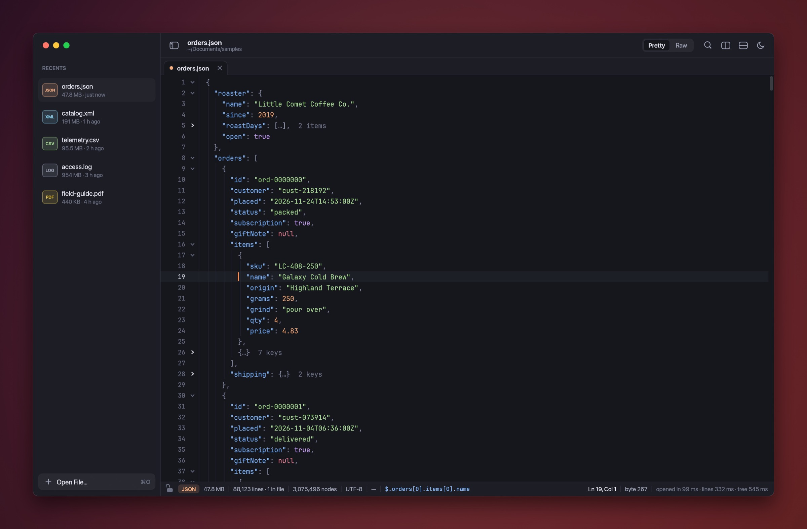
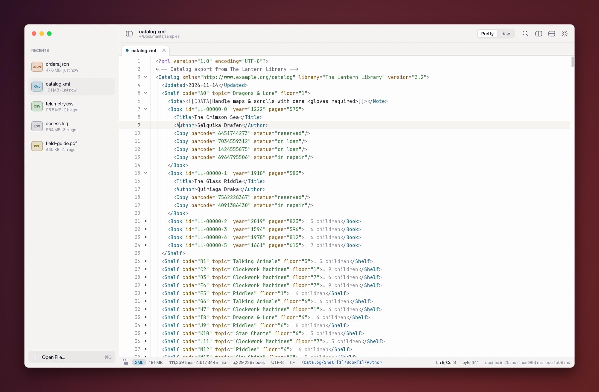
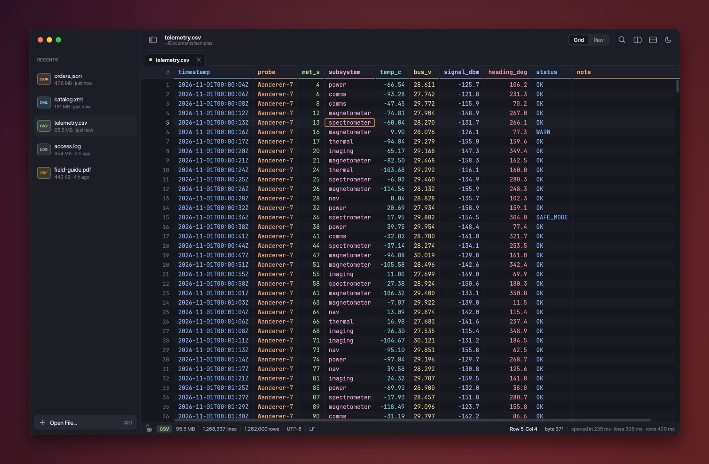
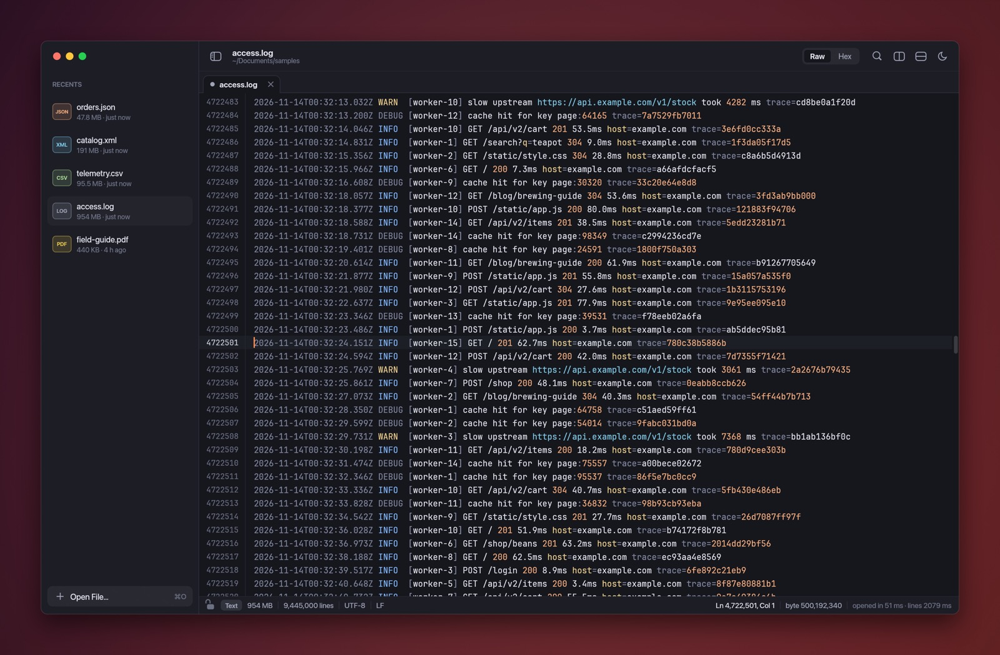
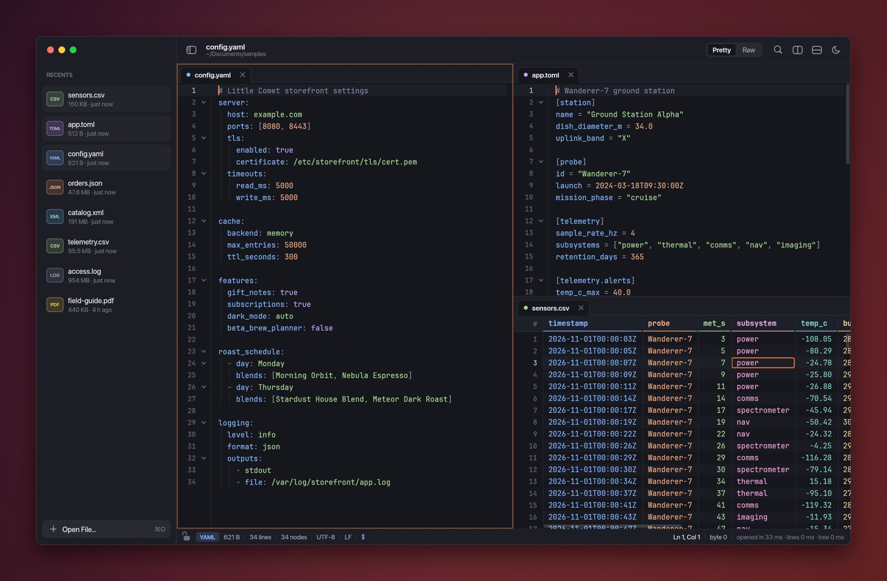
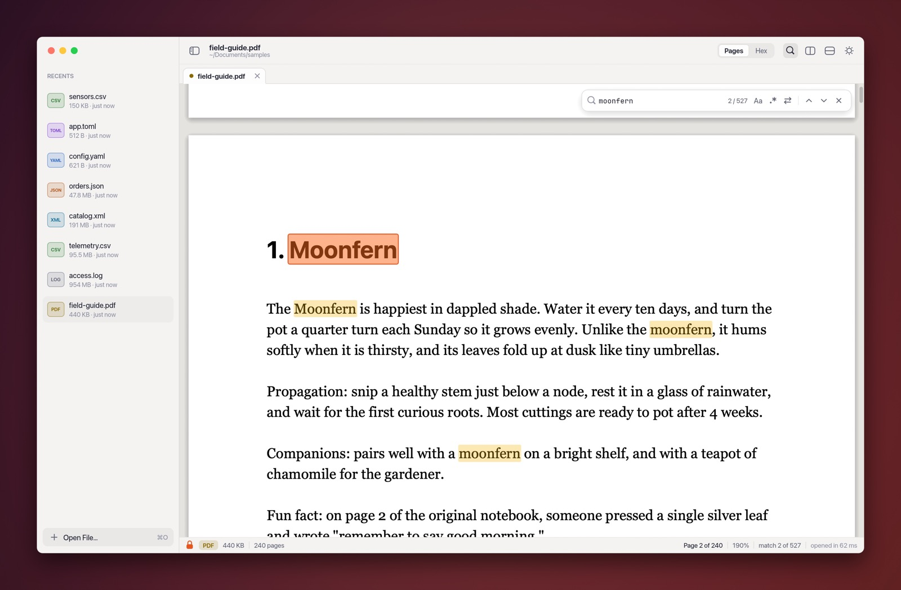

 
 

<picture>
  <source media="(prefers-color-scheme: dark)" srcset=".github/assets/wordmark-on-dark.svg">
  
</picture>

### Giant files, one bite

A fast Mac app for viewing and editing very large JSON, XML, CSV, YAML, TOML and log files. And PDFs, too.

 

 
 

 
 

 

## Why Chomp

<table>
<tr>
<td width="50%" valign="top">

### ⚡ Opens anything, instantly
A 1 GB log, a 50 MB single-line JSON export, a 200 MB XML feed: the first screen appears right away while Chomp finishes indexing in the background. Scrolling stays smooth however big the file gets.

</td>
<td width="50%" valign="top">

### 🌳 Structure you can see
Minified JSON and XML open as a tidy, foldable tree with summaries like `{…} 12 keys` and `[…] 1,204 items`. The path of the caret, such as `$.orders[0].items[1].name`, is always in view.

</td>
</tr>
<tr>
<td width="50%" valign="top">

### ✍️ Edit, even when it's huge
Type straight into the formatted view, even of a minified file, with unlimited undo. Saving keeps the file's original compact style unless you choose otherwise, and never leaves a half-written file behind.

</td>
<td width="50%" valign="top">

### 🔍 Find it fast
Search plain text or regular expressions across the whole file in the background, with a live match count, folds that open to reveal each match, and Replace All in one undo step.

</td>
</tr>
<tr>
<td width="50%" valign="top">

### 🪟 Side by side
Tabs, splits in any direction, drag-and-drop panes and linked scrolling. Your window, tabs and layout come back the next time you open Chomp.

</td>
<td width="50%" valign="top">

### 🍎 At home on your Mac
Light and dark, a full menu bar, a command palette for everything, Finder's Open With, Dock and drag-and-drop opening, and an optional `chomp` command for your terminal.

</td>
</tr>
</table>

 

 

## Every format you throw at it

| | |
|---|---|
| **JSON & JSON Lines** | A formatted, foldable tree of any JSON, even one long line; bracket matching, JSON paths and parse errors marked at the exact spot. |
| **JSONC** | Comments and trailing commas welcome: `tsconfig.json`, VS Code settings, `.jsonc` and `.json5` files. |
| **XML** | Elements, comments and CDATA as a tree with `… 34 children` summaries and the XPath of the caret. |
| **YAML & TOML** | Folding by structure, syntax highlighting, paths like `$.server.ports[1]`, and errors shown in place. Lock files too. |
| **CSV & TSV** | A grid with a sticky header, right-aligned numbers and rainbow columns, delimiters detected for you, quoted multi-line fields handled correctly. |
| **Logs & text** | Timestamps, levels, numbers, URLs and `key=value` pairs highlighted, in files of any size. |
| **Config files** | INI, `.properties`, `.env`, `.editorconfig` and friends, with sections you can fold. |
| **PDF** | Smooth continuous scrolling through documents of any length, zoom, find on every page, text selection and copying, and working links. |
| **Anything else** | A hex view for binary files, and UTF-8 or UTF-16 text with any line endings. |

 

 

## Install

1. [Download the latest release](https://github.com/mccannjustin17/chomp-releases/releases/latest) (`Chomp-<version>.dmg`).
2. Open it and drag **Chomp** into your **Applications** folder.
3. Open Chomp and drop a file on it, or press **⌘O**.

The first time Chomp opens on its own, it offers to become the default app for JSON, XML, CSV, text, YAML and TOML files. Untick anything you'd rather keep in its current app, or choose **Not now**. You can come back to it any time from **Chomp › Default Apps…**, which can also install the `chomp` terminal command.

**Requirements:** macOS 13 Ventura or later, on Apple silicon or Intel. Chomp is signed and notarized by Apple.

## Updates

Chomp checks this page for a new version about once a day and shows a small **Update available** button when there is one. You'll see what's new, and choose **Install and Relaunch**, **Later** or **Skip This Version**. Every update is checked against its published SHA-256 checksum and must carry Chomp's own Developer ID signature before it's installed. Turn automatic checks off in **Settings** (⌘,), or check any time with **Chomp › Check for Updates…**

See what changed in each version on the [releases page](https://github.com/mccannjustin17/chomp-releases/releases).

## Privacy

Your files stay on your Mac. Chomp has no accounts, no analytics and no tracking.

The only time Chomp goes online is the update check: it asks GitHub (`api.github.com`) for the latest release, and downloads an update from GitHub only when you choose to install it. With automatic checks turned off, Chomp makes no network connections unless you choose **Check for Updates…**

Links you click in a PDF open in your browser or mail app.

## Feedback & support

Found a bug or have an idea? [Open an issue](https://github.com/mccannjustin17/chomp-releases/issues/new/choose). For security reports, please see [SECURITY.md](SECURITY.md).

 

© 2026 Chomp. All rights reserved. JetBrains Mono is used under the SIL Open Font License. Mac and macOS are trademarks of Apple Inc.

