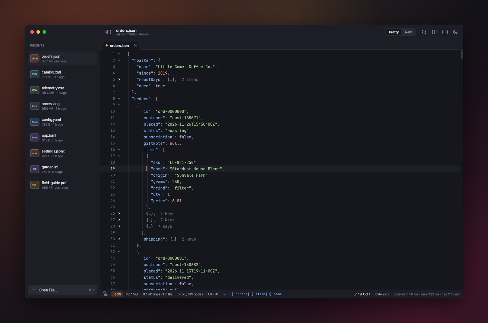
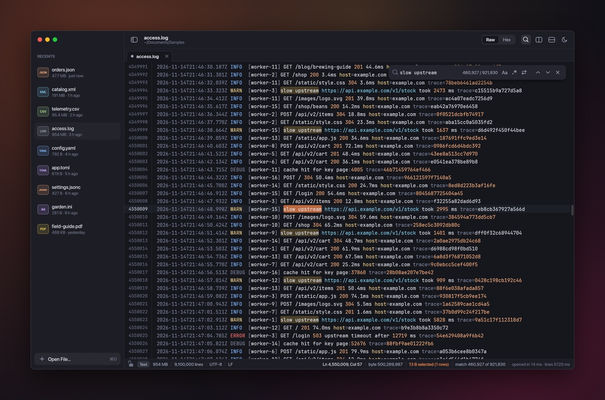
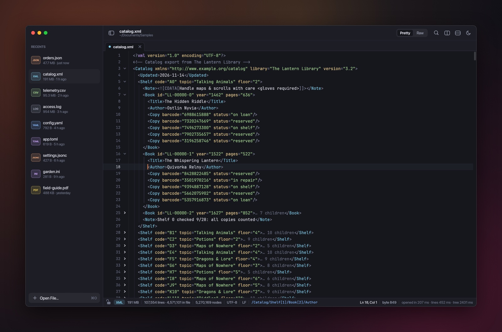
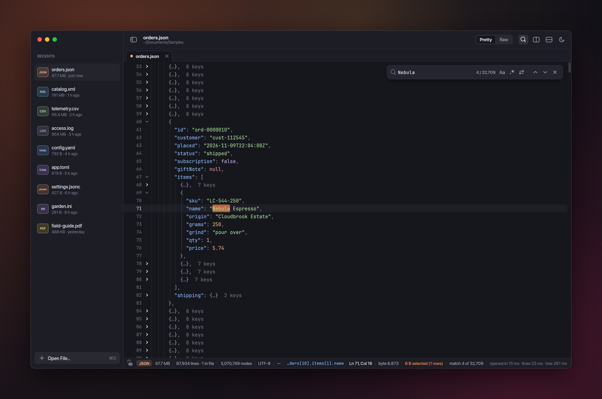
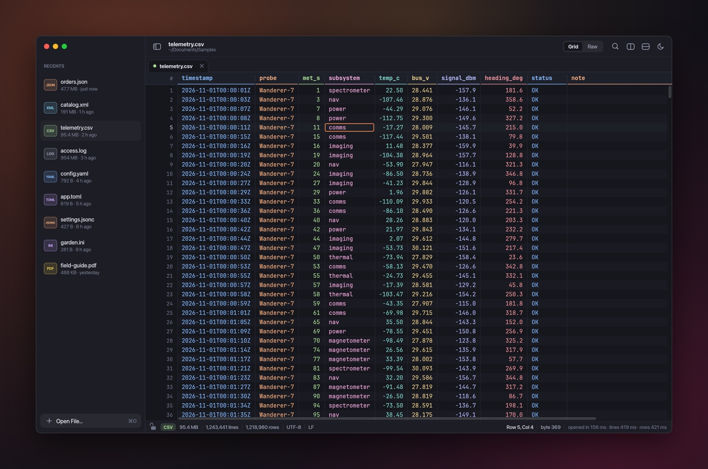
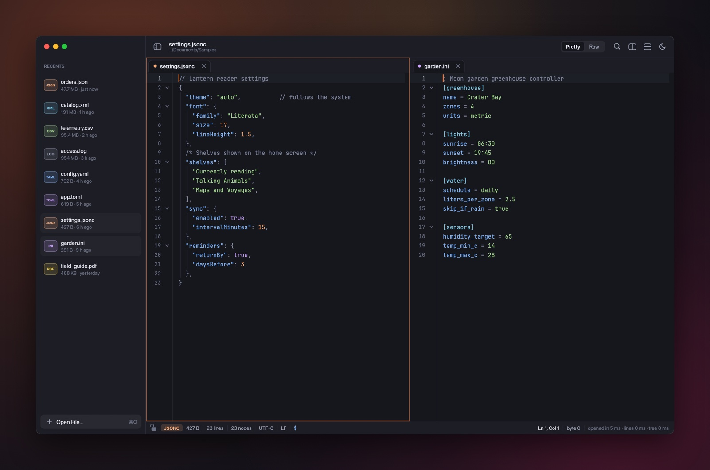
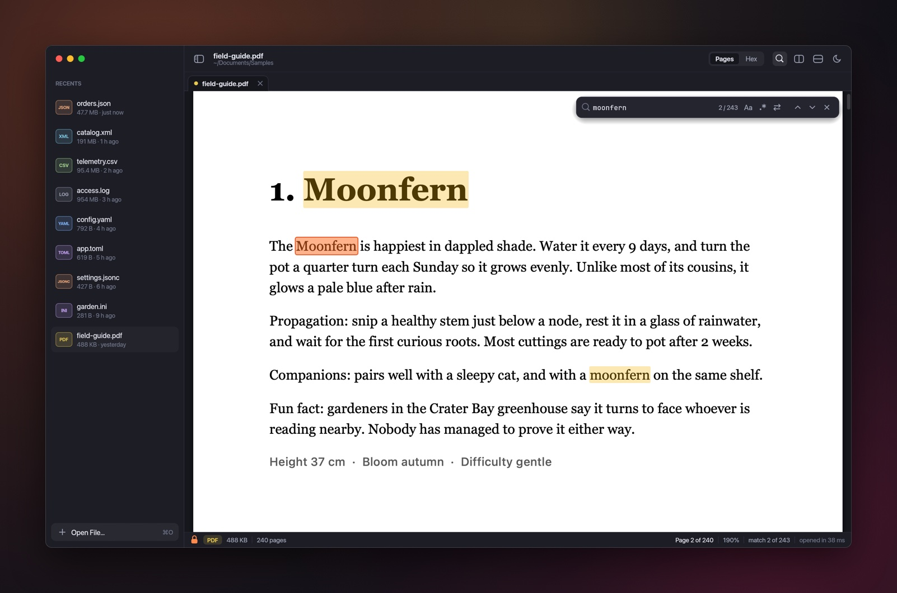
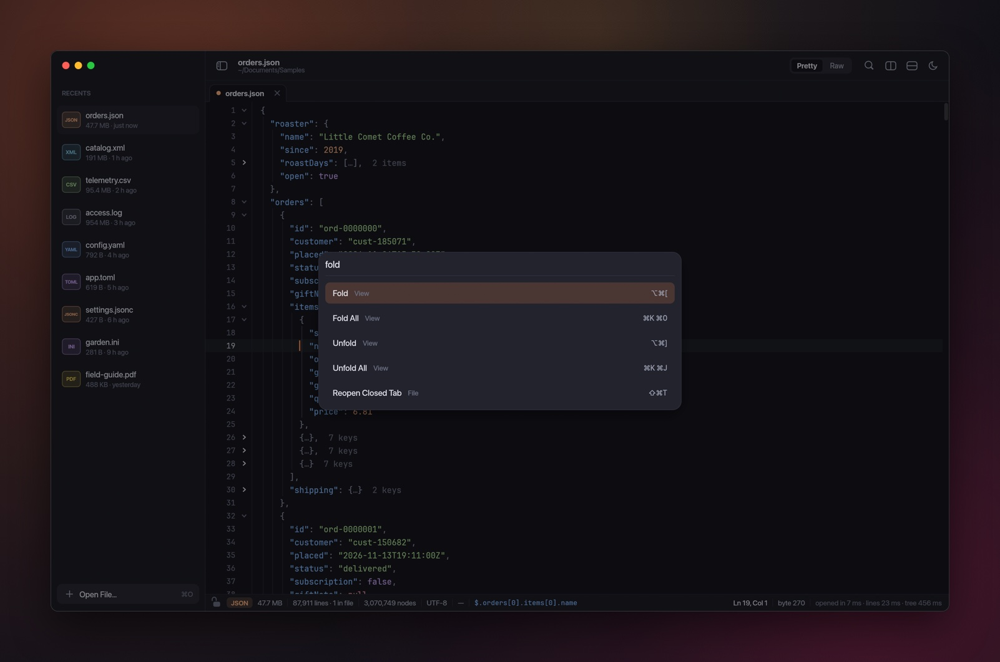
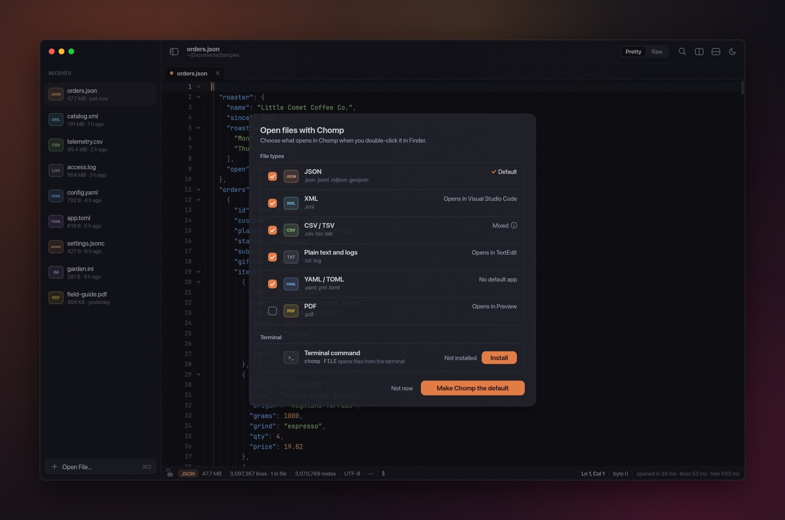
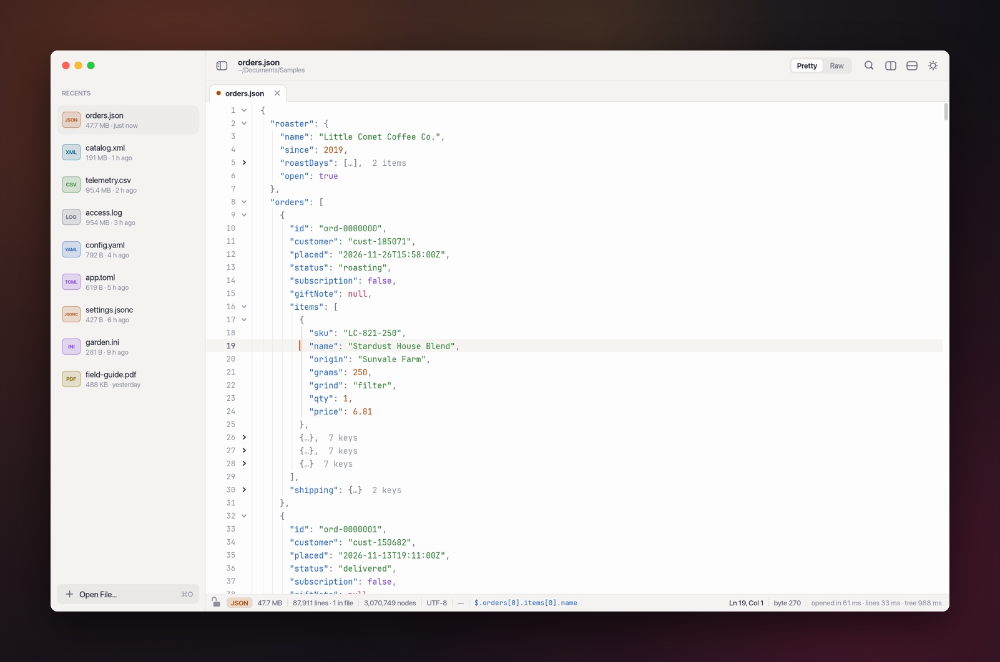

 
 

<picture>
  <source media="(prefers-color-scheme: dark)" srcset=".github/assets/wordmark-on-dark.svg">
  
</picture>

### Giant files, one bite

The fast Mac app for viewing and editing huge JSON, XML, CSV, YAML, TOML and log files. And PDFs, too.

 

 
 

 
 

<a href="https://github.com/mccannjustin17/chomp-releases/blob/main/.github/assets/chomp-film.mp4">▶ Watch the full film with sound (55 seconds)</a>

 
 

 

## Why Chomp

<table>
<tr>
<td width="50%" valign="top">

### ⚡ Opens anything, in a blink
A 1 GB log, a 50 MB single-line JSON export, a 200 MB XML feed: the first screen is there the moment you open it, and the rest is ready a heartbeat later. Scrolling stays smooth from the first line to the ten millionth.

</td>
<td width="50%" valign="top">

### 🌳 Structure you can see
Minified JSON and XML open as a tidy, foldable tree with summaries like `{…} 12 keys` and `[…] 1,204 items`. The path of the caret, such as `$.orders[0].items[1].name`, is always in view.

</td>
</tr>
<tr>
<td width="50%" valign="top">

### ✍️ Edit, even when it's huge
Type straight into the formatted view of a minified file, with unlimited undo. Chomp saves it back in its original compact shape, and never leaves a half-written file behind.

</td>
<td width="50%" valign="top">

### 🔍 Find it fast
Search plain words or regular expressions across the whole file while you keep working, with a live count, folds that open to show each match, and Replace All in one undo step.

</td>
</tr>
<tr>
<td width="50%" valign="top">

### 🗂️ Every format you throw at it
JSON, JSON Lines and JSON with comments, XML, YAML, TOML, CSV and TSV, INI and `.env` files, logs, plain text and PDFs. Anything else opens as text or hex.

</td>
<td width="50%" valign="top">

### 🍎 At home on your Mac
Light and dark, tabs and splits, a command palette, shortcuts for everything, Open With from Finder and a `chomp` command for Terminal. Free, private and signed by Apple.

</td>
</tr>
</table>

 

## Built for big files

Most apps read a whole file before they show you anything, and give up on the big ones. Chomp shows the first screen straight away, whatever the size, and gets the rest ready in the background while you read. A 1 GB log is ready to scroll in a blink, and every keystroke lands instantly, even at line ten million.

- **Jump anywhere.** Go to any line, or line and column, with <kbd>⌘L</kbd>. <kbd>⌃-</kbd> takes you back.
- **Logs that are easy on the eyes.** Timestamps, levels, numbers, strings, URLs and `key=value` pairs in color.
- **Light on memory**, however big the file.
- **Keeps up with changes.** When a file changes on disk, Chomp tells you and reloads it in a click.

 

## Minified JSON and XML, instantly readable

A whole export on one line opens as a clean, indented tree. Fold anything away, or collapse everything to level one, two or three, and see what is inside at a glance from summaries like `[…] 1,204 items` and `<Book …>… 7 children</Book>`.

- **Always know where you are.** The JSON path or XPath of the caret sits in the status bar, and <kbd>⌥⌘C</kbd> copies it.
- **Brackets that match**, indent guides that keep long lists in line, and short elements kept on one line.
- **Mistakes, pinpointed.** A broken file still opens, with the problem marked at the exact spot.
- **JSON Lines** files work too, one record after another.

 

## Edit right in the tidy view

Click into any value in the formatted view of a minified file and type. Chomp changes just those characters and keeps the file's shape, so it's instant even in a 48 MB single-line file. Add a new line or a bracket and Chomp formats the document for you behind the scenes, in the same undo step.

- **Saved the way it came.** A compact file is saved compact again, unless you flip the status bar switch to **Save formatted**.
- **Safe saves.** Chomp writes a complete new copy and swaps it in, keeping permissions, line endings and the byte order mark, so a file is never left half written.
- **Real editing tools.** Unlimited undo grouped the way you typed, cut, copy and paste, auto-indent, move, copy and delete lines, select the next match with <kbd>⌘D</kbd>, **Format Document** and **Minify**.
- **Nothing lost.** A dot marks unsaved tabs, and Chomp asks before closing anything with changes. Files you can't write open read-only, and <kbd>⌥⌘R</kbd> locks any file.

 

## Find it fast

<kbd>⌘F</kbd> searches the whole file in the background while you keep working, with a live count of every match. Use plain words or regular expressions, match case or not, and folds open up to show each match. **Replace** and **Replace All** work in every editable file, and Replace All is a single undo step.

 

## CSV and TSV as a real grid

A header that stays put, numbers lined up on the right, zebra rows and a color for every column, so even wide files stay readable. Commas, semicolons, tabs or pipes are detected for you, and quoted fields that span several lines just work. Switch to the raw view to see every column in its own color, and edit the text directly.

 

## Every format you throw at it

| | |
|---|---|
| **JSON and JSON Lines** | A formatted, foldable tree of any JSON, even one long line, with bracket matching, JSON paths and errors marked in place. |
| **JSON with comments** | Comments and trailing commas welcome: `.jsonc` and `.json5` files, `tsconfig.json`, `jsconfig.json`, `devcontainer.json`, `.babelrc` and VS Code settings. |
| **XML** | Elements, comments, CDATA and processing instructions as a tree, with `… 34 children` summaries and the XPath of the caret. |
| **YAML and TOML** | Folding that follows the file as written, syntax colors, paths like `$.server.ports[1]` and `server.ports[1]`, and errors shown in place. Lock files such as `Cargo.lock` and `poetry.lock` too. |
| **CSV and TSV** | A grid with a sticky header, or a raw view with rainbow columns. |
| **Config files** | INI, `.properties`, `.env` and `.env.*`, `.editorconfig`, `.gitconfig`, `.npmrc` and friends, with sections you can fold and `section.key` paths. |
| **Logs and text** | Timestamps, levels, numbers, URLs and `key=value` pairs highlighted in files of any size, with word wrap when you want it (<kbd>⌥Z</kbd>). |
| **PDF** | Smooth scrolling through any number of pages, zoom with <kbd>⌘=</kbd> and <kbd>⌘-</kbd> or a pinch, find on every page, go to any page, text selection and copying, and links that work. |
| **Anything else** | UTF-8 and UTF-16 text with any line endings, and a hex view for binary files. |

 

## Side by side

Open as many tabs as you like and split the window in any direction, as many times as you like. Drag a tab, or a file from Finder, onto the edge of a pane to open it there, and turn on linked scrolling to move two views in step. Pin the tabs you keep coming back to, and reopen a closed one with <kbd>⇧⌘T</kbd>. Your window, tabs and layout are waiting next time you open Chomp.

 

## At home on your Mac

- **Command palette.** Every command is one search away with <kbd>⇧⌘P</kbd>, and <kbd>⌘P</kbd> reopens any recent file.
- **Shortcuts for everything**, all listed under **Help › Keyboard Shortcuts** (<kbd>⌘/</kbd>), with the full menu bar you'd expect.
- **Your default app, your way.** Choose which file types open in Chomp when you double-click them in Finder, and leave the rest where they are.
- **A `chomp` command.** Open files from Terminal as new tabs in the running window, or pipe anything in with `chomp -`.
- **Recent and pinned files** in a sidebar you can resize or tuck away, plus Dock and drag-and-drop opening.
- **Bigger or smaller text** with <kbd>⌘=</kbd> and <kbd>⌘-</kbd>, and full screen with <kbd>⌃⌘F</kbd>.

 

## Dark and light

Chomp follows your Mac's appearance, with careful contrast in both themes, and switches the moment you do.

<table>
<tr>
<td width="50%"></td>
<td width="50%"></td>
</tr>
</table>

 

## Install

1. [Download the latest release](https://github.com/mccannjustin17/chomp-releases/releases/latest) (`Chomp-<version>.dmg`).
2. Open it and drag **Chomp** into your **Applications** folder.
3. Open Chomp and drop a file on it, or press **⌘O**.

The first time Chomp opens on its own, it offers to become the default app for JSON, XML, CSV and TSV, text and logs, and YAML and TOML files. Untick anything you'd rather keep in its current app, or choose **Not now**. You can come back to it any time from **Chomp › Default Apps…**, which can also install the `chomp` terminal command.

Chomp is free, with every feature. **Requirements:** macOS 13 Ventura or later, on Apple silicon or Intel. Chomp is signed and notarized by Apple.

## Updates

Chomp checks this page for a new version about once a day and shows a small **Update available** button when there is one. You'll see what's new, and choose **Install and Relaunch**, **Later** or **Skip This Version**. Every update is checked against its published SHA-256 checksum and must carry Chomp's own Developer ID signature before it's installed. Turn automatic checks off in **Settings** (⌘,), or check any time with **Chomp › Check for Updates…**

See what changed in each version on the [releases page](https://github.com/mccannjustin17/chomp-releases/releases).

## Privacy

Your files stay on your Mac. Chomp has no accounts, no analytics and no tracking.

The only time Chomp goes online is the update check: it asks GitHub (`api.github.com`) for the latest release, and downloads an update from GitHub only when you choose to install it. With automatic checks turned off, Chomp makes no network connections unless you choose **Check for Updates…**

Links you click in a PDF open in your browser or mail app.

## Feedback & support

Found a bug or have an idea? [Open an issue](https://github.com/mccannjustin17/chomp-releases/issues/new/choose). For security reports, please see [SECURITY.md](SECURITY.md).

 

© 2026 Chomp. All rights reserved. JetBrains Mono is used under the SIL Open Font License. Mac and macOS are trademarks of Apple Inc.

